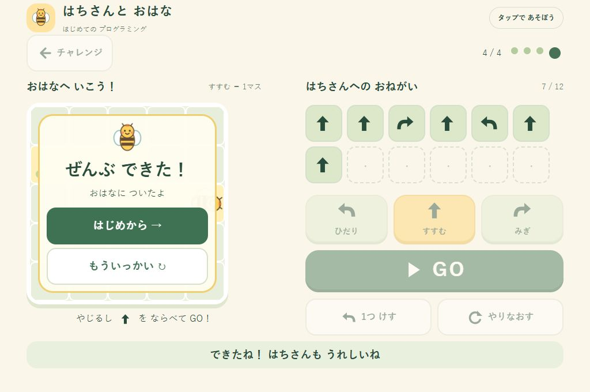

# 動作検証記録

検証日：2026年10月15日（日本時間）。対象：Issue #1 の初期完成版。

## 検証環境

- 開発PC：Windows 11 Pro。インストール済みChromeのバージョン：155.0.8059.40。
- ブラウザー操作：接続中のChromeで `http://127.0.0.1:8765/index.html` を開いて実施。
- 表示領域：1024×768、およびブラウザーの枠を見込んだ1024×680。表示倍率100%相当。
- 自動テスト：Node.js v24.21.0、外部パッケージ不使用。CIはNode.js 22で同じテストを実行。

検証用HTTPサーバーは開発時の画面確認にだけ使用しました。配布ゲームはインラインCSS・JavaScript・SVGを含む `index.html` だけで構成され、サーバーを起動する処理や外部ファイルの読み込みはありません。

## 自動テスト：16件すべて成功

```text
node --test tests/game.test.cjs
tests 16 / pass 16 / fail 0
```

| 確認内容 | 結果 |
| --- | --- |
| かんたんの1・2・3・4マス、チャレンジ全4課題の解答 | 成功 |
| 前進1マス、左右90度回転、四方向への移動 | 成功 |
| 命令の順番を変えた場合の違い | 成功 |
| 最後の位置でのゴール判定、ゴールの通過・未到達・盤外 | 成功 |
| 命令追加、任意の1命令削除、最後の1命令削除、全消去、12命令上限 | 成功 |
| 実行中の編集・GO連打防止、現在の命令の強調 | 成功 |
| GO時の開始位置への復帰、失敗後の修正、再挑戦、次問題、モード切替 | 成功 |
| 外部画像・スクリプト・スタイル・通信・保存APIの不使用 | 成功（ソース検査） |
| 古いブラウザーで問題になる新構文の検査 | 成功（ES5の保守的な構文検査。完全なパーサー検証ではない） |

ゲームルールと実際に配布するUIスクリプトを読み込み、UIは簡易DOMと制御したタイマーで検証しています。実際のブラウザー描画や物理的なタッチ操作は、この自動テストで検証したことにはなりません。

## ブラウザーでの実操作

| 確認内容 | 結果 |
| --- | --- |
| 起動時の2モード選択 | 成功 |
| かんたん全4課題、チャレンジ全4課題をボタンで入力して完走 | 成功 |
| 前進・左右回転のアニメーション、現在の命令表示 | 成功 |
| 実行中にGO・方向ボタンが無効になる | 成功 |
| 命令一覧の途中の命令削除、最後の取り消し | 成功 |
| 未到達の失敗メッセージ、命令を残す、全消去・再挑戦 | 成功 |
| 成功演出、次課題、最終課題から先頭へ、同じ課題の再挑戦 | 成功 |
| ブラウザーの再読み込みでモード選択に戻る | 成功 |
| JavaScriptのコンソールエラー・警告 | 検証操作中は0件 |
| 1024×768のかんたん画面 | ページ寸法1024×768、スクロールなし |
| 1024×680のチャレンジ画面・成功画面 | ページ寸法1024×680、スクロールなし |
| 表示される操作ボタンの領域 | 最小64px。命令カード64×64px、編集ボタン高さ64px |
| 縮小レイアウトの成功画面「もういっかい」 | 高さ64px、下端493.5px、成功パネル下端508.5px内に収まる |

成功画面のボタンが小さな表示領域ではみ出さないように、レビュー後に余白と配置を修正しました。回転命令と混同しないよう、盤面の説明は「すすむ ＝ 1マス」としました。



## 未検証事項と確認の限界

- **`file://` のブラウザー実操作と、ネットワークを物理的に切った状態での再起動は未検証**です。ブラウザー検証ツールのURL制限により `file://` を開けなかったため、画面操作は許可されたローカルHTTP環境で実施しました。外部依存・通信処理の不使用はソースと自動テストで確認しています。対象PCでREADMEのオフライン確認を実施してください。
- **Windows 8実機、Chrome 109、Firefox 115 ESRは未検証**です。これらで動作する設計ですが、現在のChromeでの確認を動作保証に置き換えることはできません。
- 物理的なタッチパネル、タッチドライバー、複数の指での操作、タッチ後の互換マウスイベントは未検証です。ボタンは標準の `click` だけで扱い、タッチとマウスを二重に登録する実装はしていません。
- 低スペックPCの描画速度、OSの拡大率、ブラウザーの拡大率を変えた状態は未検証です。
- 1024pxより狭い画面は補助的なレイアウトです。主対象は1024×768のPCで、狭い画面でのスクロール不要は保証していません。

授業前に [タッチ操作チェックリスト](touch-checklist.md) を対象PCで確認してください。
