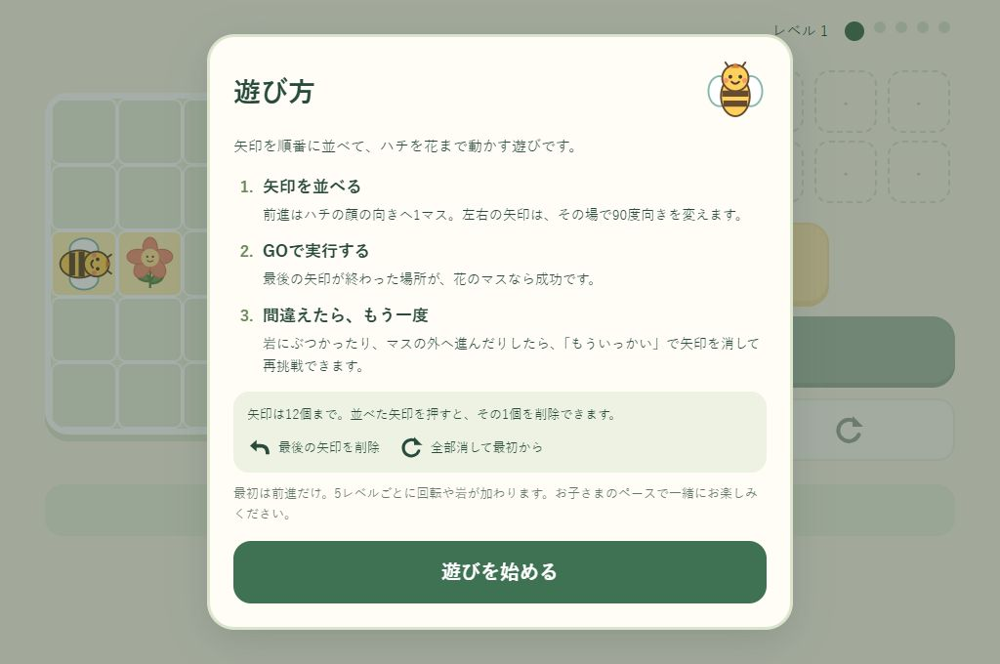
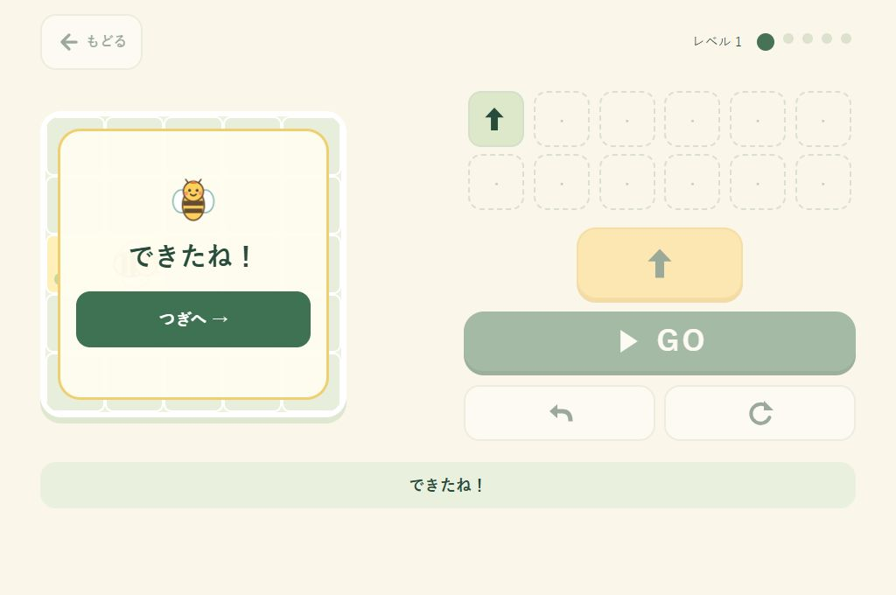
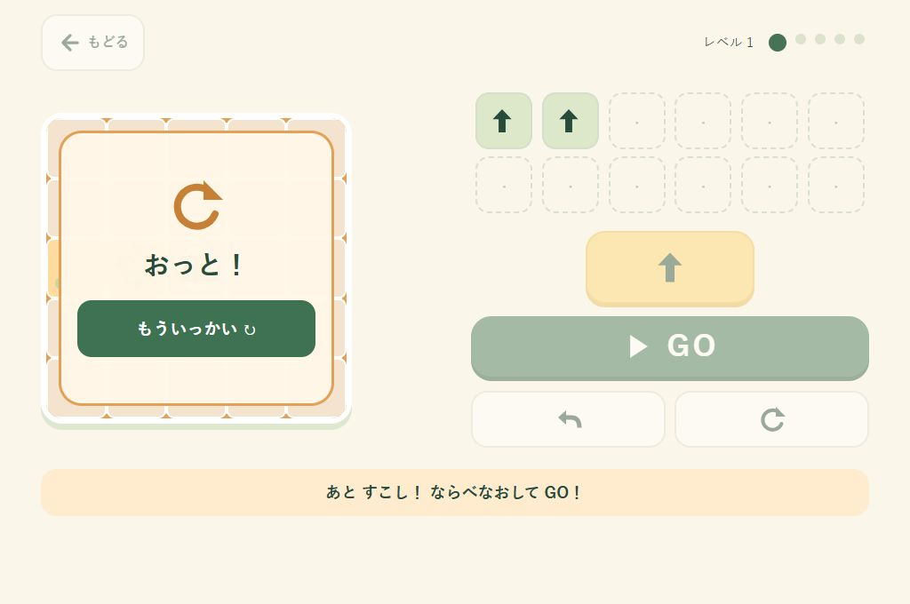
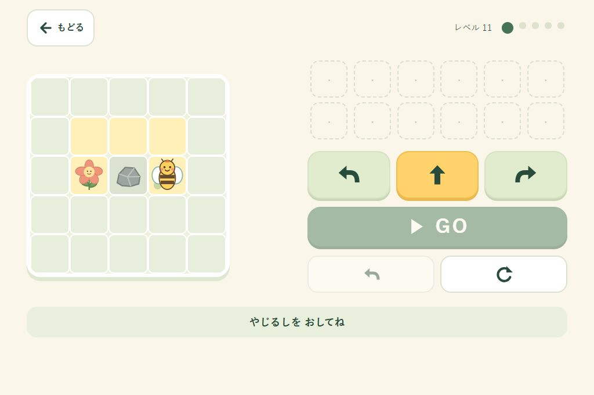

# 動作検証記録

## 2026年10月16日：開始前の遊び方説明

アクセス時に「遊び方」のダイアログを表示し、「遊びを始める」を押してから操作できるようにしました。説明は漢字を使い、見出しは「遊び方」だけにしています。再読み込み時は再表示し、レベル移動・再挑戦では表示しません。

- `node --test`：26件すべて成功（ゲーム16件、公開処理10件）。開始前の入力・実行の無効化、開始後の操作、新しいアクセス時の再表示を追加検証。既存のレベル31までの進行・再挑戦も成功。
- 内蔵ブラウザーの1024×680と375×812で、説明と開始ボタンがダイアログ内に収まり、横にはみ出さないことを確認。
- 説明からTabで開始ボタンへ移動し、Enterで開始できることを確認。レベル1成功→レベル2、失敗→再挑戦で説明が再表示されないことも確認。
- 検証中のJavaScriptエラー・警告は0件。旧ブラウザーと物理タッチは未検証です。



## 2026年10月16日：スタートの目印と戻るボタンを削除

スタート地点の緑の丸と、前のレベルへ戻るボタンを削除しました。レベル表示の周囲の余白も縮めています。`node --test` は25件すべて成功し、内蔵ブラウザーで新しい画面を確認しました。以下の過去の記録にある前のレベルへの移動は廃止しています。

## 2026年10月16日：再挑戦で矢印をリセット

「もういっかい」を押すと矢印をすべて消し、同じレベルのスタートに戻す仕様に変更しました。以下の過去の記録にある「命令を残す」動作は廃止しています。

`node --test`：25件すべて成功。内蔵ブラウザーでも、失敗後に「もういっかい」を押すと命令数が0になり、ハチがスタートへ戻り、GOが無効になることを確認しました。

## 2026年10月16日：成功時の操作を「つぎへ」に統一

成功ダイアログの「もういっかい」を削除し、「つぎへ」だけにしました。盤外へ進んだ際の「1つ けして ためそう」は、1命令の削除で解決するとは限らないため、「もういっかい ためしてみよう」に変更しました。

`node --test`：25件すべて成功。内蔵ブラウザーで成功ダイアログに「つぎへ」だけが表示されることを確認しました。以下の過去の記録には変更前の成功時再プレイ操作も含みます。



## 2026年10月16日：失敗ダイアログと再挑戦

失敗時にもダイアログを開き、「もういっかい」ボタンを1つ表示します。ダイアログ表示中は背後の編集・実行・レベル移動を無効にします。ボタンを押すと同じ盤面のスタートに戻り、入力済みの命令を残して編集できます。

- `node --test`：25件すべて成功（ゲーム15件、公開処理10件）。未到達、通り過ぎ、盤外、岩への衝突のすべてで失敗ダイアログと再挑戦を確認。
- 命令・レベルの保持、再挑戦後の編集の再開、修正して成功した後のダイアログ切り替えを自動検証。
- 内蔵ブラウザーの1024×680表示で、前進を2回入力して失敗→「もういっかい」→1命令削除→成功の流れを確認。失敗時は再挑戦ボタンへフォーカスが移り、Tabでもダイアログ内に留まることを確認。
- 幅375pxの画面でも失敗ダイアログ全体が表示範囲内に収まり、再挑戦ボタンの高さが64px以上あることを確認。



## 2026年10月16日：レベル制への変更

モード選択を廃止し、起動時にレベル1を表示します。5レベルごとに直進、回転、岩、長い回り道、複数回の回転へ進み、26〜30は道のヒントを一部に、31以降はヒントなしにします。その先も盤面の向きと岩の配置を変えて続けます。レベル数・プレイ回数に終了条件はありません。盤面は5×5、入力は12命令までです。

### 自動検証

`node --test`：23件すべて成功（ゲーム13件、公開処理10件）。

- レベル1〜500、および1000・10001・1000000の503課題で、生成の再現性、盤面内の配置、岩と正解経路の非重複を確認。
- 正解が12命令以内に収まり、独立した探索でもゴールに到達でき、意図しない近道がないことを確認。
- 実際のUIスクリプトを簡易DOMと制御タイマーでレベル31まで実行。5レベルごとの境界、前のレベルへ戻る、同じ課題の再挑戦、編集、実行中のロック、岩・盤外での停止を確認。
- オフライン単一HTMLと保守的なES5構文の検査、および公開用HTMLの生成検査に成功。

### ブラウザーでの確認

Codex内蔵ブラウザーで `http://127.0.0.1:8765/index.html` を開いて確認しました。

- レベル1〜11を実操作でクリア。レベル6で回転ボタン、レベル11で岩が現れることを確認。
- レベル11で岩へ進むと手前で止まり、命令が残り、メッセージが変化。全消去後、回り道の命令で成功し、「もういっかい」で同じ盤面へ戻ることを確認。
- 1024×680と900×680でページの横・縦スクロールなし。12命令の配置が操作ボタンに重ならないことを確認。
- 幅375pxの表示では縦スクロールを使用。横にはみ出さず、12個の命令ボタンは64×64pxを維持。
- 確認中のJavaScriptエラー・警告は0件。



Windows 8実機、旧ブラウザー、物理タッチ、オフラインでの再起動は今回未検証です。以下は変更前の初期版の記録であり、現在のレベル制の動作結果とは区別してください。

## 初期版の検証記録（2026年10月15日）

検証日：2026年10月15日（日本時間）。対象：Issue #1 の初期完成版。

## 検証環境

- 開発PC：Windows 11 Pro。インストール済みChromeのバージョン：155.0.8059.40。
- ブラウザー操作：接続中のChromeで `http://127.0.0.1:8765/index.html` を開いて実施。
- 表示領域：1024×768、およびブラウザーの枠を見込んだ1024×680。表示倍率100%相当。
- 自動テスト：Node.js v24.21.0、外部パッケージ不使用。CIはNode.js 22で同じテストを実行。

検証用HTTPサーバーは開発時の画面確認にだけ使用しました。配布ゲームはインラインCSS・JavaScript・SVGを含む `index.html` だけで構成され、サーバーを起動する処理や外部ファイルの読み込みはありません。

## 自動テスト：16件すべて成功

```text
node --test tests/game.test.cjs
tests 16 / pass 16 / fail 0
```

| 確認内容 | 結果 |
| --- | --- |
| かんたんの1・2・3・4マス、チャレンジ全4課題の解答 | 成功 |
| 前進1マス、左右90度回転、四方向への移動 | 成功 |
| 命令の順番を変えた場合の違い | 成功 |
| 最後の位置でのゴール判定、ゴールの通過・未到達・盤外 | 成功 |
| 命令追加、任意の1命令削除、最後の1命令削除、全消去、12命令上限 | 成功 |
| 実行中の編集・GO連打防止、現在の命令の強調 | 成功 |
| GO時の開始位置への復帰、失敗後の修正、再挑戦、次問題、モード切替 | 成功 |
| 外部画像・スクリプト・スタイル・通信・保存APIの不使用 | 成功（ソース検査） |
| 古いブラウザーで問題になる新構文の検査 | 成功（ES5の保守的な構文検査。完全なパーサー検証ではない） |

ゲームルールと実際に配布するUIスクリプトを読み込み、UIは簡易DOMと制御したタイマーで検証しています。実際のブラウザー描画や物理的なタッチ操作は、この自動テストで検証したことにはなりません。

## ブラウザーでの実操作

| 確認内容 | 結果 |
| --- | --- |
| 起動時の2モード選択 | 成功 |
| かんたん全4課題、チャレンジ全4課題をボタンで入力して完走 | 成功 |
| 前進・左右回転のアニメーション、現在の命令表示 | 成功 |
| 実行中にGO・方向ボタンが無効になる | 成功 |
| 命令一覧の途中の命令削除、最後の取り消し | 成功 |
| 未到達の失敗メッセージ、命令を残す、全消去・再挑戦 | 成功 |
| 成功演出、次課題、最終課題から先頭へ、同じ課題の再挑戦 | 成功 |
| ブラウザーの再読み込みでモード選択に戻る | 成功 |
| JavaScriptのコンソールエラー・警告 | 検証操作中は0件 |
| 1024×768のかんたん画面 | ページ寸法1024×768、スクロールなし |
| 1024×680のチャレンジ画面・成功画面 | ページ寸法1024×680、スクロールなし |
| 表示される操作ボタンの領域 | 最小64px。命令カード64×64px、編集ボタン高さ64px |
| 縮小レイアウトの成功画面「もういっかい」 | 高さ64px、下端493.5px、成功パネル下端508.5px内に収まる |

成功画面のボタンが小さな表示領域ではみ出さないように、レビュー後に余白と配置を修正しました。回転命令と混同しないよう、盤面の説明は「すすむ ＝ 1マス」としました。


## 未検証事項と確認の限界

- **`file://` のブラウザー実操作と、ネットワークを物理的に切った状態での再起動は未検証**です。ブラウザー検証ツールのURL制限により `file://` を開けなかったため、画面操作は許可されたローカルHTTP環境で実施しました。外部依存・通信処理の不使用はソースと自動テストで確認しています。対象PCでREADMEのオフライン確認を実施してください。
- **Windows 8実機、Chrome 109、Firefox 115 ESRは未検証**です。これらで動作する設計ですが、現在のChromeでの確認を動作保証に置き換えることはできません。
- 物理的なタッチパネル、タッチドライバー、複数の指での操作、タッチ後の互換マウスイベントは未検証です。ボタンは標準の `click` だけで扱い、タッチとマウスを二重に登録する実装はしていません。
- 低スペックPCの描画速度、OSの拡大率、ブラウザーの拡大率を変えた状態は未検証です。
- 1024pxより狭い画面は補助的なレイアウトです。主対象は1024×768のPCで、狭い画面でのスクロール不要は保証していません。

授業前に [タッチ操作チェックリスト](touch-checklist.md) を対象PCで確認してください。
